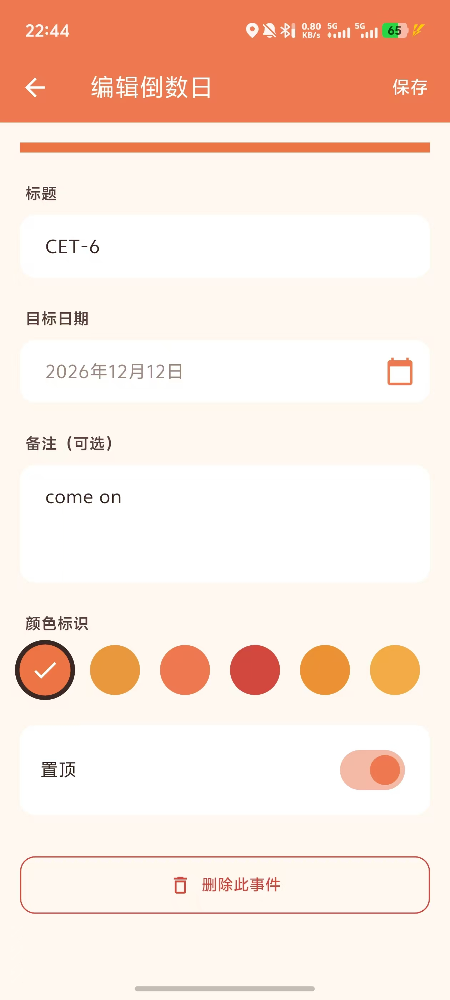

# 倒数日（Countdown Day）

> **当前版本：v2.0** —— 新增 3 个动画（Hero 共享元素、AnimatedContainer、AnimatedScale），详见 [版本更新](#版本更新) 与 [动画说明](#动画说明)

一款简洁温暖的倒数日 App，用 Flutter 开发，适配安卓手机。记录那些值得期待的未来，也纪念那些已经走过的日子。

- **未来事件**：显示「还有 XX 天」，比如考试、生日、假期
- **过去事件**：显示「已过 XX 天」，比如毕业、入职、在一起的日子

纯前端项目，无后端，数据通过 `shared_preferences` 本地持久化。

## 打开方式

**在线体验地址**：https://shale-orbit.github.io/countdown_day/

用手机浏览器扫码或直接访问上面的链接即可打开，无需安装：


> ⚠️ **首次打开提示**：Web 版需要下载约 4MB 的渲染引擎资源，首次加载会比较慢，请耐心等待几分钟（页面会显示加载动画）。加载完成后浏览器会自动缓存，之后再打开就很快了。
>
> 另外，如果是在**微信**里打开，会提示「请在浏览器中打开」——微信内置浏览器不支持该应用，请点击右上角 `···` 选择「在浏览器打开」。

## 运行效果

### v1.0

首发版本包含首页列表与新建事件页：首页卡片展示倒数天数与颜色标识，新建页可填写标题、日期、备注并选择配色。

| 首页 | 新建倒数日 |
|------|-----------|
|  |  |

### v2.0

v2.0 在编辑页顶部新增贯穿整屏的主题色带，颜色选择支持缩放与勾选反馈，整体视觉更连贯。



## 版本更新

### v2.0（当前版本）

**新增 3 个动画效果**

- **Hero 共享元素动画**：点击卡片进入编辑页时，卡片左侧的彩色标识条「飞」到页面顶部并横向展开成色带，页面切换有连续的视觉引导
- **AnimatedContainer 隐式动画**：编辑页顶部色带的颜色随所选颜色平滑过渡（400ms），切换配色时不会生硬跳变
- **AnimatedScale 隐式动画**：点击颜色标识时，圆形色块放大到 1.2 倍并显示白色勾选图标，带弹性缩放反馈

**其他调整**

- 编辑页顶部新增主题色带，与卡片的颜色标识形成呼应
- 页面路由过渡时长调整为 500ms，缩放弹性更自然

### v1.0

- 首发版本：倒数 / 正数两种模式、事件增删改、置顶、6 种橙红配色、本地持久化
- 3 个基础动画：卡片交织入场、天数数字切换、自定义路由过渡

## 功能特性

- **倒数 / 正数两种模式**：未来事件自动显示「还有 XX 天」，过去事件显示「已过 XX 天」，当天显示「就是今天」
- **事件管理**：新建、编辑、删除事件（删除带二次确认）
- **事件字段**：标题、目标日期、备注（可选）、颜色标识、是否置顶
- **6 种橙红系配色**：给每个事件选一个个性的颜色标识条
- **置顶功能**：重要的事件钉在最上面
- **智能排序**：置顶优先，其余按距离今天的天数从近到远排列
- **本地持久化**：数据保存在手机本地，杀掉进程重开不丢失
- **暖色橙红主题**：橙红渐变 AppBar + 米白背景，视觉温暖舒适

## 技术栈

| 技术 | 用途 |
|------|------|
| Flutter / Dart | 跨平台 UI 框架与开发语言 |
| shared_preferences | 本地数据持久化（JSON 字符串存取） |
| Material Design 3 | UI 设计语言与组件库 |

## 项目结构

```
lib/
├── main.dart                        # 入口 + 橙红暖色调主题
├── models/
│   └── countdown_event.dart         # 事件数据模型（fromJson / toJson / copyWith）
├── services/
│   └── storage_service.dart         # shared_preferences 存取（单例）
├── pages/
│   ├── home_page.dart               # 首页（列表 + 交织动画 + 自定义路由过渡）
│   └── edit_page.dart               # 添加 / 编辑页（Hero 色带 + 隐式动画）
├── widgets/
│   └── countdown_card.dart          # 事件卡片（Hero 色条 + AnimatedSwitcher 数字动画）
└── utils/
    └── date_util.dart               # 日期工具（天数差计算、格式化）
```

## 动画说明

参考《Flutter 实战》第九章动画，共实现 **6 个动画效果**：v1.0 三个基础动画 + v2.0 三个新增动画。

### v1.0 基础动画

#### 1. 交织动画（Staggered Animation）— 首页卡片入场

进入首页或刷新列表时，卡片依次「淡入 + 上滑」入场，形成错落有致的节奏感。

- 实现：单个 `AnimationController`（800ms），每张卡片按索引计算 `Interval(start, end)` 错开 80ms 启动
- 效果组合：`Opacity`（透明度 0→1）+ `Transform.translate`（Y 轴偏移 20→0）
- 代码位置：[home_page.dart](lib/pages/home_page.dart) 的 `_buildAnimatedCard`

#### 2. AnimatedSwitcher — 卡片天数数字切换

卡片上的大数字发生变化时（比如跨天），旧数字淡出、新数字淡入并上滑归位，避免生硬跳变。

- 实现：`AnimatedSwitcher` 包裹数字 `Text`，以 `ValueKey<int>(absDays)` 作为 key
- 过渡效果：`FadeTransition` + `SlideTransition`（起始偏移 0.3）
- 代码位置：[countdown_card.dart](lib/widgets/countdown_card.dart)

#### 3. 自定义路由过渡动画 — 进入添加 / 编辑页

点击「+」或点击卡片时，目标页面从中心「缩放 + 淡入」弹出，带轻微弹性。

- 实现：`PageRouteBuilder` + `transitionsBuilder`
- 效果组合：`FadeTransition`（`Curves.easeOut`）+ `ScaleTransition`（`Curves.easeOutBack` 弹性曲线）
- 时长：500ms
- 代码位置：[home_page.dart](lib/pages/home_page.dart) 的 `_openEditPage`

### v2.0 新增动画

#### 4. Hero 共享元素动画 — 卡片色条飞入编辑页

点击卡片进入编辑页时，卡片左侧 6px 宽的彩色标识条通过 `Hero` 共享元素，从卡片位置「飞」到编辑页顶部，并展开成贯穿整屏宽度的色带，让页面切换有连续的视觉引导。

- 实现：卡片侧用 `Hero(tag: 'event-color-<id>')` 包裹左侧色条，编辑页侧用相同 tag 包裹顶部色带
- 关键点：两端 tag 必须一致；新建事件时 tag 用 `new` 占位
- 代码位置：[countdown_card.dart](lib/widgets/countdown_card.dart)（源）、[edit_page.dart](lib/pages/edit_page.dart)（目标）

#### 5. AnimatedContainer 隐式动画 — 顶部色带颜色过渡

编辑页顶部的色带在切换颜色时，颜色会从旧色平滑过渡到新色（400ms，`Curves.easeOut`），不会突然跳变。

- 实现：`AnimatedContainer` 包裹色带，`color` 绑定当前选中颜色，`duration: 400ms`
- 代码位置：[edit_page.dart](lib/pages/edit_page.dart)

#### 6. AnimatedScale 隐式动画 — 颜色圆点选中放大

点击颜色标识时，被选中的圆形色块会平滑放大到 1.2 倍，并显示白色勾选图标；取消选中时缩回原尺寸。

- 实现：`AnimatedScale` 包裹色块，`scale: isSelected ? 1.2 : 1.0`，`duration: 200ms`
- 代码位置：[edit_page.dart](lib/pages/edit_page.dart)

## 运行方式

### 环境要求

- Flutter SDK 3.x
- Android SDK（真机调试或模拟器）

### 安装依赖

```bash
flutter pub get
```

### 运行

连接安卓手机（开启 USB 调试）或启动模拟器后：

```bash
flutter run
```

### 构建 APK

```bash
flutter build apk --debug
```

产物路径：`build/app/outputs/flutter-apk/app-debug.apk`

### 真机安装（adb）

```bash
adb install -r build/app/outputs/flutter-apk/app-debug.apk
```

### 静态检查与测试

```bash
flutter analyze   # 静态检查
flutter test      # 单元测试（日期工具、数据模型）
```

## 数据存储

所有事件保存在手机本地的 shared_preferences 中，以 JSON 字符串形式存储，无需网络、无需登录。卸载 App 会清除数据。
