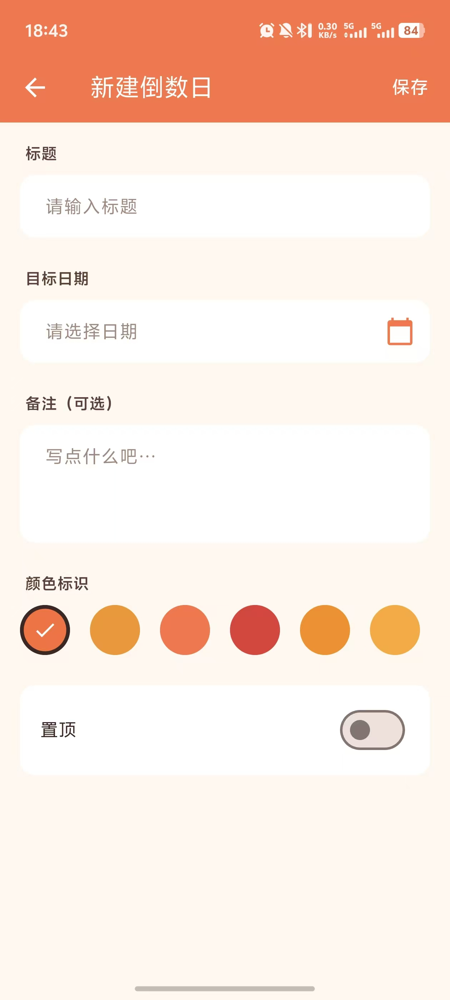

# 倒数日（Countdown Day）

一款简洁温暖的倒数日 App，用 Flutter 开发，适配安卓手机。记录那些值得期待的未来，也纪念那些已经走过的日子。

- **未来事件**：显示「还有 XX 天」，比如考试、生日、假期
- **过去事件**：显示「已过 XX 天」，比如毕业、入职、在一起的日子

纯前端项目，无后端，数据通过 `shared_preferences` 本地持久化。

## 运行效果

| 首页 | 新建倒数日 |
|------|-----------|
|  |  |

## 功能特性

- **倒数 / 正数两种模式**：未来事件自动显示「还有 XX 天」，过去事件显示「已过 XX 天」，当天显示「就是今天」
- **事件管理**：新建、编辑、删除事件（删除带二次确认）
- **事件字段**：标题、目标日期、备注（可选）、颜色标识、是否置顶
- **6 种橙红系配色**：给每个事件选一个个性的颜色标识条
- **置顶功能**：重要的事件钉在最上面
- **智能排序**：置顶优先，其余按距离今天的天数从近到远排列
- **本地持久化**：数据保存在手机本地，杀掉进程重开不丢失
- **暖色橙红主题**：橙红渐变 AppBar + 米白背景，视觉温暖舒适

## 技术栈

| 技术 | 用途 |
|------|------|
| Flutter / Dart | 跨平台 UI 框架与开发语言 |
| shared_preferences | 本地数据持久化（JSON 字符串存取） |
| Material Design 3 | UI 设计语言与组件库 |

## 项目结构

```
lib/
├── main.dart                        # 入口 + 橙红暖色调主题
├── models/
│   └── countdown_event.dart         # 事件数据模型（fromJson / toJson / copyWith）
├── services/
│   └── storage_service.dart         # shared_preferences 存取（单例）
├── pages/
│   ├── home_page.dart               # 首页（列表 + 交织动画 + 自定义路由过渡）
│   └── edit_page.dart               # 添加 / 编辑页（同一页面两种模式）
├── widgets/
│   └── countdown_card.dart          # 事件卡片（含 AnimatedSwitcher 数字动画）
└── utils/
    └── date_util.dart               # 日期工具（天数差计算、格式化）
```

## 动画说明

参考《Flutter 实战》第九章动画，共实现 3 个动画效果：

### 1. 交织动画（Staggered Animation）— 首页卡片入场

进入首页或刷新列表时，卡片依次「淡入 + 上滑」入场，形成错落有致的节奏感。

- 实现：单个 `AnimationController`（800ms），每张卡片按索引计算 `Interval(start, end)` 错开 80ms 启动
- 效果组合：`Opacity`（透明度 0→1）+ `Transform.translate`（Y 轴偏移 20→0）
- 代码位置：`lib/pages/home_page.dart` 的 `_buildAnimatedCard`

### 2. AnimatedSwitcher — 卡片天数数字切换

卡片上的大数字发生变化时（比如跨天），旧数字淡出、新数字淡入并上滑归位，避免生硬跳变。

- 实现：`AnimatedSwitcher` 包裹数字 `Text`，以 `ValueKey<int>(absDays)` 作为 key
- 过渡效果：`FadeTransition` + `SlideTransition`（起始偏移 0.3）
- 代码位置：`lib/widgets/countdown_card.dart`

### 3. 自定义路由过渡动画 — 进入添加 / 编辑页

点击「+」或点击卡片时，目标页面从中心「缩放 + 淡入」弹出，带轻微弹性。

- 实现：`PageRouteBuilder` + `transitionsBuilder`
- 效果组合：`FadeTransition`（`Curves.easeOut`）+ `ScaleTransition`（`Curves.easeOutBack` 弹性曲线）
- 时长：300ms
- 代码位置：`lib/pages/home_page.dart` 的 `_openEditPage`

## 运行方式

### 环境要求

- Flutter SDK 3.x
- Android SDK（真机调试或模拟器）

### 安装依赖

```bash
flutter pub get
```

### 运行

连接安卓手机（开启 USB 调试）或启动模拟器后：

```bash
flutter run
```

### 构建 APK

```bash
flutter build apk --debug
```

产物路径：`build/app/outputs/flutter-apk/app-debug.apk`

### 真机安装（adb）

```bash
adb install -r build/app/outputs/flutter-apk/app-debug.apk
```

### 静态检查与测试

```bash
flutter analyze   # 静态检查
flutter test      # 单元测试（日期工具、数据模型）
```

## 数据存储

所有事件保存在手机本地的 shared_preferences 中，以 JSON 字符串形式存储，无需网络、无需登录。卸载 App 会清除数据。
